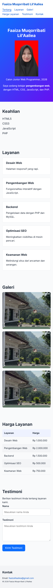
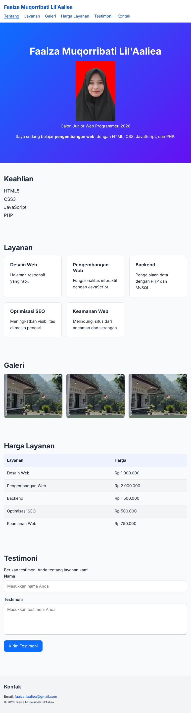
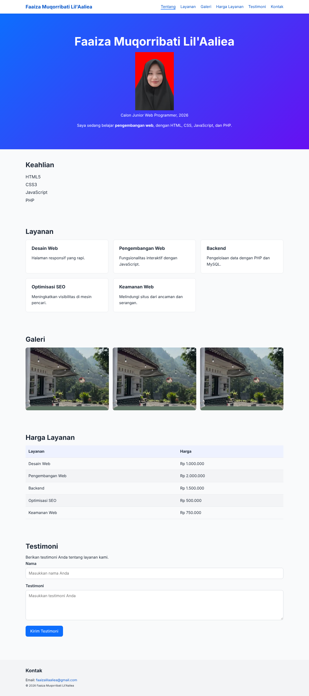

# Proyek 1: Landing Page Profil Responsif

Landing page profil pribadi Faaiza Muqorribati Lil'Aaliea (calon Junior Web Programmer), dibuat pada Diklat Junior Web Programmer Hari 3.

## Tema

Profil dan layanan pengembangan web, dengan tampilan bersih berwarna biru-ungu.

## Fitur

- Navbar sticky berbasis Flexbox, menu membungkus di bawah logo pada ponsel
- Hero, Keahlian, Layanan (kartu Grid), Galeri (Grid auto-fit), Tabel harga, Form testimoni, Kontak
- Desain responsif mobile-first (360, 768, 1280 px)
- Efek `:hover` pada tombol dan kartu, `:focus` pada input dan link
- Variabel CSS untuk warna dan jarak, tanpa `style` inline dan tanpa `!important`
- Mendukung `prefers-reduced-motion`

## Teknologi

HTML5, CSS3 (Flexbox, Grid, variabel CSS, media query), GitHub Pages

## Demo

https://faaizaaliea.github.io/portofolio-junior-web/

## Tangkapan Layar

| Ponsel (360 px)                        | Tablet (768 px)                        | Desktop (1280 px)                        |
| -------------------------------------- | -------------------------------------- | ---------------------------------------- |
|  |  |  |

## Skor Lighthouse

Dijalankan di tautan GitHub Pages (lihat `screenshot/lighthouse-github-pages.png`).

| Kategori       | Skor                         |
| -------------- | ---------------------------- |
| Accessibility  | 100                          |
| Best Practices | ... (isi setelah dijalankan) |
| SEO            | 100                          |

## Bukti Pengujian

| Berkas                                           | Keterangan                                                  |
| ------------------------------------------------ | ----------------------------------------------------------- |
| `screenshot/360.png`, `768.png`, `1280.png`      | Tampilan versi akhir di tiga lebar layar                    |
| `screenshot/lighthouse-github-pages.png`         | Lighthouse pada tautan GitHub Pages                         |
| `screenshot/lighthouse-lokal-sebelum.png`        | Lighthouse awal di server lokal                             |
| `screenshot/devtools-768-navbar-bug-sebelum.png` | Bug navbar di 768 px sebelum diperbaiki (lihat `TEMUAN.md`) |
| `screenshot/devtools-360-harga-testimoni.png`    | Uji ponsel 360 px lewat Device Toolbar                      |
| `screenshot/devtools-1280-hero-sebelum.png`      | Uji desktop 1280 px lewat Device Toolbar                    |

## Struktur Folder

```
hari-03-css/
├── index.html
├── css/style.css
├── img/
├── screenshot/
├── TEMUAN.md
└── README.md
```
