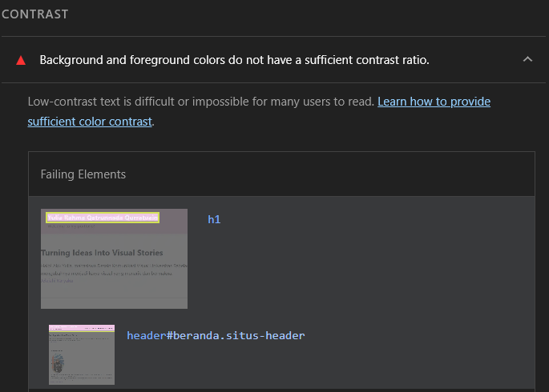

# Code Review Sejawat Hari 3

Hasil review saya terhadap halaman landing page teman (Proyek 1), memakai ceklis dari modul.

- Halaman yang ditinjau: ........................
- Reviewer: Faaiza Muqorribati Lil'Aaliea

## Ceklis

| Butir                                       | Ya/Tidak | Catatan                                                           |
| ------------------------------------------- | -------- | ----------------------------------------------------------------- |
| Penamaan class deskriptif dan konsisten     | Ya       |                                                                   |
| Tidak ada `style` inline dan `!important`   | Ya       |                                                                   |
| Warna dan jarak memakai variabel            | Ya       |                                                                   |
| Tampil baik di 360, 768, 1280 px            | Ya       | Tidak ada scrollbar horizontal, tetapi belum full width di 360 px |
| Kontras dan fokus terlihat                  | Kurang   | Lighthouse melaporkan kontras tidak cukup                         |
| Tautan dan gambar berfungsi di GitHub Pages | Ya       |                                                                   |

## Bukti: temuan kontras (Lighthouse)

Lighthouse: _Background and foreground colors do not have a sufficient contrast ratio._
Elemen yang gagal: `h1` dan `header#beranda.situs-header`.

## Saran perbaikan

1. Periksa lebar kontainer dan padding agar tampilan memenuhi lebar layar di 360 px.
2. Ubah warna teks atau latar pada `h1` dan header agar kontras mencapai minimal 4,5:1.
