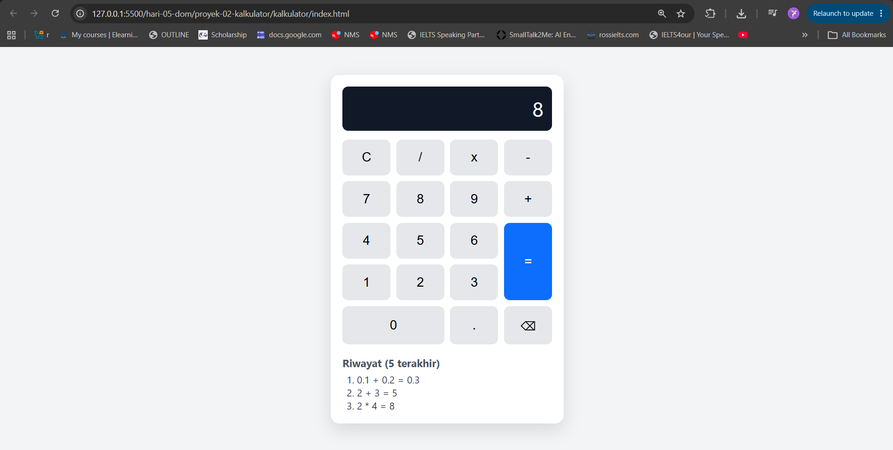
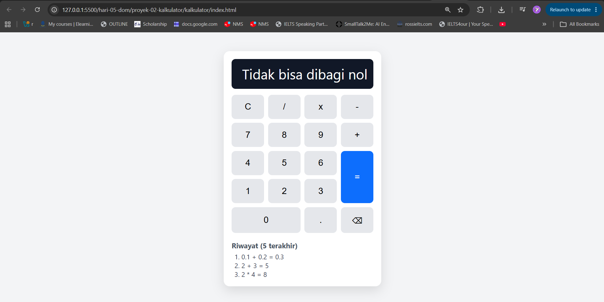
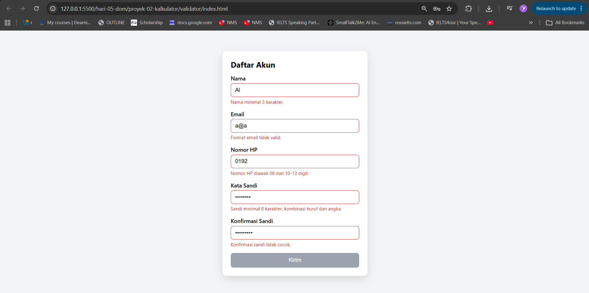
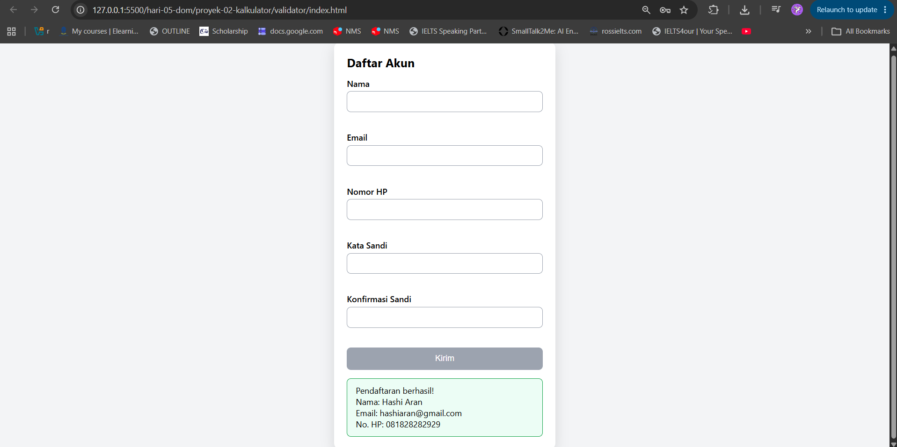

# Proyek 2 - Kalkulator dan Form Validator

PBL Hari 5. Dua mini-aplikasi memakai HTML, CSS, dan JavaScript (ES Modules).

## Struktur

- `kalkulator/` - kalkulator dengan CSS Grid; logika di `js/operasi.js`, UI di `js/app.js`
- `validator/` - form pendaftaran dengan validasi saat mengetik dan saat dikirim; aturan di `js/aturan.js`, UI di `js/app.js`

## Cara menjalankan

Karena memakai `type="module"`, buka lewat server lokal (bukan klik dua kali file):

- VS Code: ekstensi **Live Server** > klik kanan `index.html` > Open with Live Server
- atau di terminal: `npx serve .` lalu buka `/kalkulator/` dan `/validator/`

## Fitur

**Kalkulator:** angka 0-9 dan titik, + - x /, C, =, pembagian nol menampilkan pesan,
plus tantangan: keyboard (keydown), tombol hapus satu karakter, riwayat 5 perhitungan terakhir.

**Validator:** nama, email, HP, sandi, konfirmasi sandi; pesan galat di bawah kolom;
tombol Kirim nonaktif sampai semua valid; ringkasan (tanpa sandi) lewat `textContent`.

## Uji kasus tepi

Kalkulator:

- [x] 0.1 + 0.2 = 0.3
- [x] 5 / 0 menampilkan pesan, lalu C (atau mengetik angka) memulihkan
- [x] menekan operator dua kali (operator terakhir yang dipakai)
- [x] angka diawali titik (.5 menjadi 0.5)
- [x] hasil panjang tidak merusak layout (layar bisa di-scroll)
- [x] pintasan browser (Ctrl+C, Ctrl++, Ctrl+-) tidak diblokir oleh keyboard kalkulator

Validator:

- [x] nama kurang dari 3 karakter atau hanya spasi ditolak
- [x] email tanpa titik pada domain (`a@b`) ditolak
- [x] nomor HP tidak diawali 08 atau terlalu pendek ditolak
- [x] sandi tanpa angka atau kurang dari 8 karakter ditolak
- [x] konfirmasi sandi dicek ulang saat sandi diubah
- [x] tombol Kirim nonaktif sampai semua kolom valid
- [x] `` pada nama tampil sebagai teks (aman dari XSS)
- [x] ringkasan tidak memuat sandi

## Tangkapan layar

| Kalkulator: hasil dan riwayat                                   | Kalkulator: pembagian nol                               |
| --------------------------------------------------------------- | ------------------------------------------------------- |
|  |  |

| Validator: pesan galat                            | Validator: pendaftaran berhasil                 |
| ------------------------------------------------- | ----------------------------------------------- |
|  |  |
