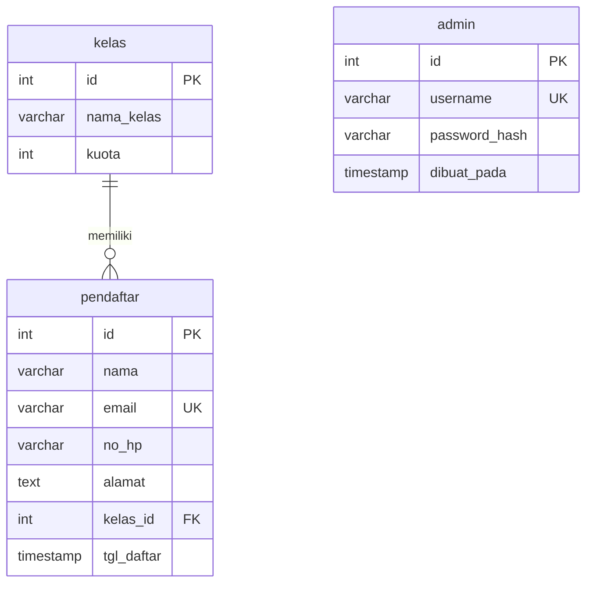

# ERD



Versi teks:

```
+----------------+          +-----------------------+      +--------------------+
| kelas          |          | pendaftar             |      | admin              |
+----------------+          +-----------------------+      +--------------------+
| id (PK)        | 1      N | id (PK)               |      | id (PK)            |
| nama_kelas     |----------| nama                  |      | username (UNIQUE)  |
| kuota          |          | email (UNIQUE)        |      | password_hash      |
+----------------+          | no_hp, alamat         |      | dibuat_pada        |
                            | kelas_id (FK)         |      +--------------------+
                            | tgl_daftar            |      (tidak berelasi)
                            +-----------------------+
```

Catatan desain
- Relasi 1-N: satu kelas memiliki banyak pendaftar; FK `ON DELETE RESTRICT` (kelas yang masih punya pendaftar tidak dapat dihapus, error 1451) dan `ON UPDATE CASCADE`.
- `email` UNIQUE (error 1062 bila ganda); index `idx_pendaftar_nama` untuk pencarian nama.
- `password_hash` VARCHAR(255) untuk hasil `password_hash()`.
- Normalisasi 3NF: nama kelas tidak diulang di tabel `pendaftar`, hanya dirujuk lewat `kelas_id`.
